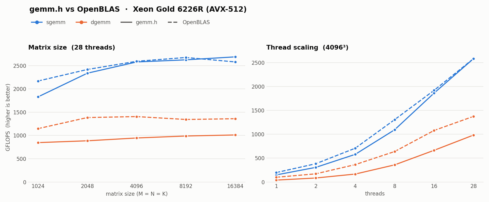
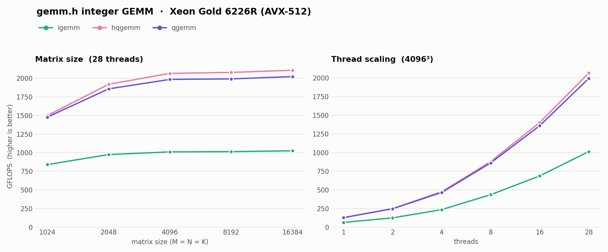

# gemm.h

A small GEMM library in C with hand-written SIMD kernels, built the way GotoBLAS does it
(cache blocking, packing, a register-tiled micro-kernel, OpenMP).

It computes `C += A × B` for row-major matrices in five data types, and runs on
**AVX-512 (F / BW / VNNI), AVX2 and AVX**. The instruction set is picked at compile time.

## Supported types and instruction sets

| Function | Type   | AVX-512F | AVX-512BW | AVX-512 VNNI | AVX2 | AVX |
|----------|--------|:--------:|:---------:|:------------:|:----:|:---:|
| `sgemm`  | float  | ✓ | ✓ | ✓ | ✓ | ✓ |
| `dgemm`  | double | ✓ | ✓ | ✓ | ✓ | ✓ |
| `igemm`  | int32  | ✓ | ✓ | ✓ | ✓ | ✓ |
| `hqgemm` | int16  | – | ✓ | ✓ | – | – |
| `qgemm`  | int8   | – | ✓ | ✓ | – | – |

- **Choosing the instruction set.** `sse.h` maps the compiler's `-march` flags to an
  `INSTLEVEL` (SSE, SSE2, SSE3, SSE4.1, SSE4.2, AVX, AVX2, AVX-512F, AVX-512BW,
  AVX-512 VNNI). The default build uses `-march=native`. To target another level:
  `make FLAGS="-std=c11 -O2 -fopenmp -Wall -march=haswell"`, or add `-DINSTLEVEL=7`
  to run the AVX2 kernels on an AVX-512 machine.
- **SSE.** The SSE levels are detected, but there are no SSE kernels yet, so an SSE-only
  build (`-msse2` … `-msse4.2`) does not compile. AVX is the lowest working level.
- **FMA.** `sgemm`/`dgemm` use `fmadd` when the CPU has FMA, and multiply + add otherwise.
- **Integers.** x86 has no int32 FMA and no int8 multiply, so `ifma` is `mullo` + `add`,
  and the int8 multiply is built from int16 operations (`ops.h`).
  All integer GEMMs accumulate in the element type itself, so results wrap on overflow;
  use a small `--bound` for meaningful values.
- **Not done yet.** `hqgemm`/`qgemm` need AVX-512BW (the AVX2 kernels are empty and do not
  compute anything). A VNNI build runs the same kernels as BW; no kernel uses the VNNI
  instructions yet.

Every supported combination above was checked against a naive GEMM with `./run -v`,
including matrix sizes that are not multiples of the tile.

## How it works

```
for jc in 0..N step NC            # 5th loop
  for pc in 0..K step KC          # 4th loop   pack B block (KC × NC)
    for ic in 0..M step MC        # 3rd loop   pack A block (MC × KC)
      parallel for jr, ir         # 2nd/1st    OpenMP collapse(2), one micro-kernel call each
        C[MR × NR] += A_panel × B_panel
```

- **Packing** (`pack.c`) copies blocks into contiguous panels, zero-padded to the tile
  size. The edge of C is handled with masked loads and stores.
- **Block sizes** (`opt.c`) are derived from the L2/L3 cache sizes read with CPUID, and
  from the element size of each data type.
- **Micro-kernels** (`kernel.c`) keep the C tile in vector registers. Each step loads
  B vectors, broadcasts A elements, and does the multiply-adds.
- **Threads** are controlled with `OMP_NUM_THREADS`.

## Build and run

```bash
make                                          # builds ./run
./run -t s -m 4096 -n 4096 -k 4096 -i 10 -p   # time sgemm and print the result
./run -t a -m 512 -n 512 -k 512 -v            # check all five types against naive GEMM
```

| Option | Meaning |
|--------|---------|
| `-t`   | `s` float, `d` double, `i` int32, `hq` int16, `q` int8, `a` all |
| `-m -n -k` | matrix sizes, `C(M×N) = A(M×K) × B(K×N)` (default 1024) |
| `-i -w`    | timed iterations (default 1) / warm-up runs (default 1) |
| `-p`, `-C` | print the result as text / as a CSV row |
| `-f`       | also append the result to a file |
| `-v`       | verify against a naive GEMM (slow for large sizes) |

### OpenBLAS reference

`reference/openblas_ref` runs OpenBLAS `sgemm`/`dgemm` with the same options and the same
CSV columns, so the two programs can be compared directly.

```bash
make -C reference   # expects OpenBLAS in ~/opt/openblas, edit reference/Makefile otherwise
./reference/openblas_ref -t s -m 4096 -n 4096 -k 4096 -i 10 -C
```

## Use as a library

```c
#include "gemm.h"

sgemm(A, B, C, M, N, K);   // C += A × B, row-major, A is M×K, B is K×N, C is M×N
```

C is accumulated into, so zero it first. Build with:

```bash
gcc -O2 -march=native -fopenmp -I. app.c opt.c gemm.c kernel.c pack.c -o app -lm
```

## Performance

2× Xeon Gold 6226R (32 cores, no hyper-threading), 28 threads pinned with `taskset -c 0-27`,
gcc 11.4 `-O2 -march=native`, OpenBLAS 0.3.34.dev. Square matrices, average GFLOPS over
10 runs (50 for N ≤ 2048). 
Left: matrix size at 28 threads. Right: thread scaling at 4096³.



The integer types have no OpenBLAS counterpart, so they are shown on their own
(`./run` reports them as GFLOPS too, counting 2·M·N·K operations). At N = 4096:
`igemm` 1,010, `hqgemm` 2,065, `qgemm` 1,984.



```bash
OMP_NUM_THREADS=28 OMP_PROC_BIND=close OMP_PLACES=cores \
  taskset -c 0-27 ./run -t s -C -m 4096 -n 4096 -k 4096 -i 10
OPENBLAS_NUM_THREADS=28 taskset -c 0-27 \
  ./reference/openblas_ref -t s -C -m 4096 -n 4096 -k 4096 -i 10
```

The machine is shared, so absolute numbers move by roughly 15–20% between runs.
Compare libraries only when they were measured back to back.

## Limitations

- **Single core is slower than OpenBLAS.** At 4096³ with one thread, sgemm reaches 149 GFLOPS
  against OpenBLAS's 198. With 28 threads the gap closes for large sizes.
- **dgemm is about 70% of OpenBLAS.** The micro-kernel itself is fine (93–99 GFLOPS alone,
  OpenBLAS 104). The loss is in blocking: all types share one block-size formula, and for
  dgemm the KC it gives (2048) is too large for the 6×16 tile. With one thread, KC = 512 is
  about 50% faster. The remaining gap at 28 threads is not fully explained yet.
- Row-major only. No transposes, no `alpha`/`beta`.
- The instruction set is fixed at compile time, so build on the machine that will run it.

## Files

| File | Role |
|------|------|
| `gemm.h`, `gemm.c` | public API and the five-loop driver for each type |
| `kernel.c` | micro-kernels (AVX-512 / AVX2 / AVX) |
| `ops.h`, `sse.h` | SIMD helpers (FMA wrappers, int8 multiply) and instruction-set detection |
| `pack.c` | packing of A and B blocks |
| `opt.c` | cache-size detection and block-size selection |
| `test.c`, `test.h`, `test_main.c` | tester `./run` with naive reference and timing |
| `report.c`, `report.h` | text/CSV output shared with the OpenBLAS reference |
| `reference/` | OpenBLAS reference program and its Makefile |

## References

- K. Goto, R. van de Geijn, *Anatomy of High-Performance Matrix Multiplication*,
  ACM TOMS 34(3), 2008.
- [salykova/matmul.c](https://github.com/salykova/matmul.c), the reference for the kernel
  and blocking layout.
- [vectorclass/version2 `instrset.h`](https://github.com/vectorclass/version2/blob/master/instrset.h),
  the model for the `INSTLEVEL` detection in `sse.h`.
